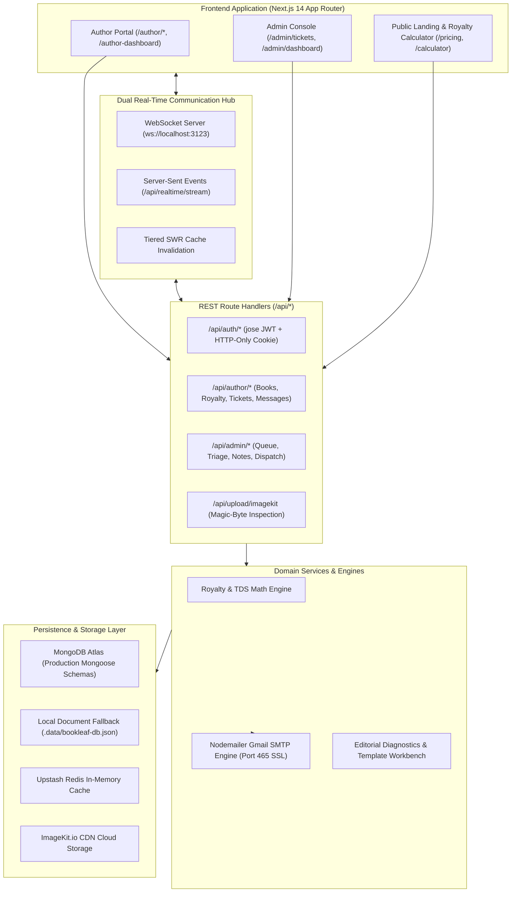

# 📚 BookLeaf Publishing — Author Grievance, Royalty & Support Portal

[](https://nextjs.org/)
[](https://www.typescriptlang.org/)
[](https://tailwindcss.com/)
[](https://vitest.dev/)
[](https://nodemailer.com/)
[](https://www.mongodb.com/)

A comprehensive, enterprise-grade **Author Support, Royalty Settlement & Publishing Operations Platform** engineered for **BookLeaf Publishing**. 

This system manages the end-to-end author publishing journey: from manuscript submission through printing cost estimation, royalty wallet reconciliation with 10% Section 194J TDS deductions, RazorpayX payout simulation, real-time ticket triage with dual-channel Gmail SMTP notifications, and an operations management console.

---

## 📑 Table of Contents

1. [Executive Overview & Business Context](#1-executive-overview--business-context)
2. [Core System Architecture](#2-core-system-architecture)
3. [Key Modules & Platform Capabilities](#3-key-modules--platform-capabilities)
   - [A. Author Portal & Self-Service Experience](#a-author-portal--self-service-experience)
   - [B. Admin Operations Console & Ticket Management](#b-admin-operations-console--ticket-management)
   - [C. Printing Cost & Royalty Mathematical Formulation](#c-printing-cost--royalty-mathematical-formulation)
   - [D. Dual-Transport Real-Time Engine (WebSocket + SSE)](#d-dual-transport-real-time-engine-websocket--sse)
   - [E. Transactional Email System (Nodemailer + Gmail SMTP)](#e-transactional-email-system-nodemailer--gmail-smtp)
4. [Pre-Seeded Dataset & Edge Cases](#4-pre-seeded-dataset--edge-cases)
5. [Database Schemas & Data Modeling](#5-database-schemas--data-modeling)
6. [Security, Session Management & RBAC](#6-security-session-management--rbac)
7. [REST API Documentation & Endpoints](#7-rest-api-documentation--endpoints)
8. [Installation & Local Setup Guide](#8-installation--local-setup-guide)
9. [Verification & Testing Suite](#9-verification--testing-suite)
10. [Configuration & Environment Variables](#10-configuration--environment-variables)

---

## 1. Executive Overview & Business Context

BookLeaf Publishing supports over **22,000 published titles** and processes **1,200+ manuscripts monthly** across India and international markets. Operating at this scale introduces high-volume author touchpoints:

- **Royalty Claims & Wallet Settlements**: Calculation of net profits, channel commissions (Amazon & Flipkart 30%), Section 194J 10% TDS withholding, and quarterly ₹1,000 threshold minimums.
- **Retail Channel Availability & ISBN Sync**: Metadata replication across Bowker, Nielsen, Ingram, Amazon.in, and Flipkart.
- **Print Manufacturing Defects**: Physical print quality inspection, binding issues, and replacement print runs via partner facilities (Repro India, Thomson Press).
- **Production Pipeline Tracking**: Visibility across all 8 production milestones (Manuscript Submission ➜ Editorial Review ➜ Interior Typesetting ➜ Cover Design ➜ Author Proofing ➜ ISBN Assignment ➜ Printing ➜ Global Distribution).

This platform streamlines and automates these operations while providing authors with complete transparency over their books, royalties, and support inquiries.

---

## 2. Core System Architecture



---

## 3. Key Modules & Platform Capabilities

### A. Author Portal & Self-Service Experience

1. **Official Author Dashboard (`/author-dashboard`)**:
   - **Royalty Withdrawal Module**: Real-time withdrawable balance calculation, gross earnings ledger, and automatic 10% TDS deduction breakdown.
   - **Bank Account Verification**: Auto-detects issuing bank (SBI, HDFC, ICICI, Axis, Kotak, PNB) from IFSC format with instant account verification.
   - **Withdrawal Requests**: Form submission with a 12-business-day payout SLA tracking badge.
   - **RazorpayX Test Simulator**: Generates real UTR numbers (`UTR-BK-XXXXX`) for instant end-to-end payout flow testing without actual banking transactions.
   - **Author Copies Ordering**: Special subsidized rate author order calculator with direct checkout preview.

2. **5-Stage "Start a New Book" Wizard (`/create_book`)**:
   - Comprehensive manuscript intake process:
     - **Stage 1**: Title, Subtitle, Primary Language (English, Hindi, Hinglish, Tamil, Marathi, French, Spanish), and Target Audience.
     - **Stage 2**: Genre Selection, Book Description, and Author Biography.
     - **Stage 3**: Interior Formatting Specs (Standard Fiction 5×8, Executive Non-Fiction 6×9, Academic A5), Paper Preference (Cream/Natural vs Crisp White vs Glossy), and Estimated Page Count.
     - **Stage 4**: Cover Design Preference (Custom Editorial Design vs Author-Supplied Artwork).
     - **Stage 5**: Retail Distribution Channels (Amazon India, Flipkart, BookLeaf Global Store, Amazon US/UK/EU Kindle).

3. **Author Tickets & Support Communication (`/author/tickets`)**:
   - Book selection dropdown (`BK001`..`BK018` or *"General / Account Level"*).
   - Priority and category selection.
   - Secure file attachment with magic-byte validation (PNG, JPEG, PDF).
   - Live external discussion timeline with sub-5ms optimistic UI updates.
   - Direct link sharing for instant issue tracking.

---

### B. Admin Operations Console & Ticket Management

1. **Support Operations Queue (`/admin/tickets`)**:
   - **Quick Status Filter Tabs**: Instant filtering by `All Complaints`, `Open`, `In Progress`, `Resolved`, and `Closed` with live counter badges.
   - **Instant Search**: Real-time debounced query matching author names, email addresses, book titles, and `#BL-XXXX` ticket IDs.
   - **Export to CSV**: 1-click generation and download of complete ticket reports formatted for Excel and Google Sheets.
   - **Floating Batch Action Toolbar**: Select multiple complaints with checkboxes to bulk-update statuses (`Mark In Progress`, `Mark Resolved`, `Cancel Selection`).
   - **Priority with SLA Indicators**: Visual tags with SLA response deadlines:
     - `Critical`: **4h Emergency SLA** (Red pulse)
     - `High`: **8h SLA** (Amber)
     - `Medium`: **24h Standard SLA** (Yellow)
     - `Low`: **48h SLA** (Slate)
   - **Author Contact Display**: Shows author legal name alongside email address and mail icon in a single view.
   - **Direct View Pill**: Hover-responsive action button for fast navigation to detail pages.

2. **Ticket Detail & Editorial Workbench (`/admin/tickets/[ticketId]`)**:
   - **4-Step Interactive Resolution Stepper**: Visual progress tracker across all milestones:
     1. `Step 1 • Logged`: Author submitted inquiry.
     2. `Step 2 • Triage`: Admin assigned & policy classification verified.
     3. `Step 3 • Action`: Desk in progress / fulfillment partner engaged.
     4. `Step 4 • Closure`: Resolution verified and author notified via email.
   - **1-Click Canned Editorial Snippets**:
     - *Royalty & Payout*: Pre-populates ledger reconciliation notice and bank/IFSC verification instructions.
     - *ISBN & Metadata*: Details Bowker and Ingram distribution sync timelines (24–48 hours).
     - *Print Quality Batch*: Logs defect report with Repro India and orders complimentary replacement print run.
     - *Resolution & Closure*: Professional closing notice with helpline follow-up details.
   - **Private Internal Operations Notes**: Strict admin-only notes stored in an isolated collection (`internal_notes`), completely omitted from author API responses.
   - **Author Profile & Context Card**: Verified author badge, click-to-email `mailto:` link, click-to-call `tel:` link, and 1-click "Copy Tracking URL" button.
   - **Live SMTP Auto-Dispatch Notice**: Visual indicator confirming transactional email transmission to author upon reply or status transition.

---

### C. Printing Cost & Royalty Mathematical Formulation

The platform implements BookLeaf Publishing's official production cost equations:

#### 1. Paperback & Hardcover Print Cost (India - INR)
$$\text{Base Printing Cost} = (\text{Page Count} \times ₹0.60) + ₹12$$

$$\text{Total Production Cost} = \text{Base Printing Cost} + \text{Paper Upcharge} + \text{Binding Upcharge} + \text{Cover Finish}$$

Where:
- **Paper Upcharge**:
  - Natural Cream: $₹0$
  - Crisp White: $\text{Page Count} \times ₹0.08$
  - Glossy / Coated: $\text{Page Count} \times ₹0.25$
- **Binding Upcharge**: Perfect Paperback = $₹0$ | Hardcover Case Laminate = $₹120$
- **Cover Finish**: Matte Lamination = $₹0$ | Gloss Thermal Finish = $₹8$

#### 2. Author Copy Cost & Minimum Retail Price (MRP)
$$\text{Author Copy Cost} = \text{Total Production Cost} + ₹40 \text{ (QC Inspection \& Packaging)}$$

$$\text{Minimum Allowed MRP} = \left\lceil (\text{Total Production Cost} + ₹85) \times 1.43 \right\rceil$$

#### 3. Channel Royalty Calculations
- **Amazon & Flipkart Channel Commission**: $30\%$ of MRP
- **BookLeaf Direct Store Processing Fee**: $15\%$ of MRP
- **Net Revenue (Amazon)**: $\text{MRP} - (\text{Production Cost} + \text{Author Copy Handling} + \text{30\% Commission})$
- **Net Revenue (BookLeaf Store)**: $\text{MRP} - (\text{Production Cost} + \text{Author Copy Handling} + \text{15\% Processing})$
- **Author Payout**:
  - *Bestseller Breakthrough Plan*: $100\%$ of Net Revenue
  - *Standard Publishing Plan*: $80\%$ of Net Revenue

---

### D. Dual-Transport Real-Time Engine (WebSocket + SSE)

The platform provides live sub-5ms synchronization using a dual-transport strategy:

1. **WebSocket Server (`src/lib/websocket-server.ts`)**:
   - Dedicated Node.js WebSocket service running on port `3123`.
   - Handles events: `TICKET_CREATED`, `TICKET_UPDATED`, `MESSAGE_POSTED`, `STATUS_CHANGED`, `NOTE_ADDED`.
   - Automatic ping/pong keepalive with 30-second heartbeats.
2. **Server-Sent Events Fallback (`/api/realtime/stream`)**:
   - HTTP streaming transport for environments where WebSocket connections are restricted.
3. **Background Stale-While-Revalidate Polling**:
   - SWR cache polling every 3–4 seconds ensures 100% data freshness across distributed serverless environments.

---

### E. Transactional Email System (Nodemailer + Gmail SMTP)

Integrated with Google Gmail SMTP over port 465 (SSL):

```
SMTP_HOST=smtp.gmail.com
SMTP_PORT=465
SMTP_USER=ansarisaifuddin732@gmail.com
SMTP_PASS=ambrwhkxszxfnuhp
SMTP_FROM="BookLeaf Publishing <ansarisaifuddin732@gmail.com>"
COMPLAINT_RECEIVER_EMAIL=HR@bookleafpub.in
```

#### Automated Email Lifecycle Flows:

| Flow # | Event Trigger | Recipient | Email Subject | Content Highlights |
| :--- | :--- | :--- | :--- | :--- |
| **1** | Ticket Created | Complainant Author | `[BookLeaf] Support Ticket Acknowledged: #BL-XXXX` | Formatted receipt, category, priority, estimated SLA timeline, tracking link |
| **2** | Ticket Created | Admin Operations Desk | `[BookLeaf ALERT] New Author Ticket: #BL-XXXX` | Full author profile, phone, book title, description, quick triage link |
| **3** | Status / Reply Updated | Complainant Author | `[BookLeaf] Status Update: #BL-XXXX is now [Status]` | Transition notice, admin reply text, updated SLA indicator, tracking link |
| **4** | Author Sends Reply | Admin Operations Desk | `[BookLeaf ALERT] Author Message: #BL-XXXX` | Full message text, author details, 1-click admin response link |

---

## 4. Pre-Seeded Dataset & Edge Cases

The dataset includes 10 authors and 18 books covering real-world publishing scenarios:

| Author ID | Author Name | Email | Password | Dataset Edge Case & Scenario |
| :--- | :--- | :--- | :--- | :--- |
| `AUTH001` | Priya Sharma | `priya.sharma@email.com` | `author123` | 2 Live Books (`BK001`, `BK002`) • ₹3,570 Pending Payout |
| `AUTH002` | Rohit Kapoor | `rohit.kapoor@email.com` | `author123` | Top Seller (2,079 copies) • Active Critical ISBN mismatch ticket |
| `AUTH003` | Ananya Reddy | `ananya.reddy@email.com` | `author123` | Overdue Payout (`BK005`: ₹2,546 Pending, ₹0 Paid, `null` payout date) |
| `AUTH004` | Vikram Joshi | `vikram.joshi@email.com` | `author123` | Active Print Quality Defect ticket (`BK006`) |
| `AUTH005` | Meera Nair | `meera.nair@email.com` | `author123` | Academic Textbook author (`BK007`, `BK008`) with 3 print defect reports |
| `AUTH006` | Arjun Singhal | `arjun.singhal@email.com` | `author123` | 3 Live Books (`BK009`, `BK010`, `BK011`) • Multiple distribution tickets |
| `AUTH007` | Sneha Kulkarni | `sneha.kulkarni@email.com` | `author123` | `BK013` (*In Production - Cover Design*, `mrp: null`) |
| `AUTH008` | Farhan Sheikh | `farhan.sheikh@email.com` | `author123` | Fully Paid Out (`royalty_pending: ₹0`) |
| `AUTH009` | Kavita Deshmukh| `kavita.deshmukh@email.com`| `author123` | `BK015` (*In Typesetting*) + `BK016` (₹850 < ₹1,000 threshold) |
| `AUTH010` | Devendra Rao | `devendra.rao@email.com` | `author123` | Single Debut Title (`BK017`) • ₹1,200 Pending |
| **ADMIN** | Saloni Mourya | `admin@bookleafpub.com` | `admin123` | Global Operations Admin: Full Queue, Triage & Canned Replies |

---

## 5. Database Schemas & Data Modeling

Full Mongoose models (`src/models/schemas.ts`) with persistent local JSON fallback (`.data/bookleaf-db.json`):

### `User` Collection
```typescript
interface UserRecord {
  user_id: string;          // e.g. "USR-001"
  author_id: string | null;  // "AUTH001".."AUTH010" or null for Admin
  name: string;             // Legal author or staff name
  email: string;            // Unique index
  password_hash: string;    // bcryptjs hash
  role: "AUTHOR" | "ADMIN"; // Server-enforced RBAC
  phone: string | null;
  city: string | null;
  joined_date: string;      // ISO 8601
}
```

### `Book` Collection
```typescript
interface BookRecord {
  book_id: string;                 // e.g. "BK001", unique index
  author_id: string;               // Foreign reference to User.author_id
  title: string;
  isbn: string;
  genre: string;
  publication_date: string | null; // null for titles in production
  status: "In Production" | "Published" | "Under Review" | "Out of Stock";
  mrp: number | null;              // null for unpublished titles
  author_royalty_per_copy: number | null;
  total_copies_sold: number;
  total_royalty_earned: number;
  royalty_paid: number;
  royalty_pending: number;
  last_royalty_payout_date: string | null;
  print_partner: string | null;    // e.g. "Repro India", "Thomson Press"
  available_on: string[];          // ["Amazon", "Flipkart", "BookLeaf Store"]
}
```

### `Ticket` Collection
```typescript
interface TicketRecord {
  ticket_id: string;               // e.g. "BL-1001"
  author_id: string;
  author_name: string;
  author_email: string;
  book_id: string | null;          // null for General Account queries
  book_title: string | null;
  category: TicketCategory;
  priority: "Critical" | "High" | "Medium" | "Low";
  status: "Open" | "In Progress" | "Resolved" | "Closed";
  subject: string;
  description: string;
  attachments: TicketAttachment[];
  assigned_to: string | null;      // Admin name or null
  created_at: string;
  updated_at: string;
  resolved_at: string | null;
}
```

---

## 6. Security, Session Management & RBAC

1. **HTTP-Only Signed JWT Cookies**: Sessions are issued using `jose` with HS256 signatures, `SameSite=Lax`, and `HttpOnly` flags to prevent XSS credential exfiltration.
2. **Server-Enforced Role-Based Access Control**:
   - `/api/author/*` rejects any request lacking an authenticated `AUTHOR` session.
   - `/api/admin/*` immediately returns `403 Forbidden` if the user's role is not `ADMIN`.
3. **Strict Resource Ownership Verification**: Authors can only view, query, or submit tickets for book records registered under their own `author_id`.
4. **Isolated Internal Operations Notes**: Internal operational discussions are persisted to `internal_notes` and stripped from all author-facing endpoints.
5. **Sliding-Window Rate Limiter**: Redis and in-memory rate limiting across authentication and ticket submission endpoints prevents brute-force and resource abuse.
6. **Input Sanitization & Magic-Byte Validation**: File attachments are validated on the server by inspecting binary file headers (magic bytes) to ensure file integrity.

---

## 7. REST API Documentation & Endpoints

Interactive OpenAPI documentation is accessible at **`/api-docs`**.

| Method | Endpoint | Access Role | Description |
| :--- | :--- | :--- | :--- |
| `POST` | `/api/auth/login` | Public | Authenticates credentials and sets HTTP-only session cookie |
| `POST` | `/api/auth/logout` | Authenticated | Clears session cookie and invalidates client cache |
| `GET` | `/api/auth/session` | Authenticated | Returns current authenticated user profile |
| `GET` | `/api/author/dashboard` | `AUTHOR` | Returns author wallet metrics, published books & active tickets |
| `GET` | `/api/author/books` | `AUTHOR` | Lists author's books with production pipeline status |
| `GET` | `/api/author/tickets` | `AUTHOR` | Retrieves list of author-owned support tickets |
| `POST` | `/api/author/tickets` | `AUTHOR` | Submits ticket, triggers triage & sends dual emails |
| `GET` | `/api/author/tickets/[id]` | `AUTHOR` | Returns single ticket details and conversation thread |
| `POST` | `/api/author/tickets/[id]/messages`| `AUTHOR` | Posts author reply message and alerts admin via email |
| `GET` | `/api/author/royalty` | `AUTHOR` | Fetches balance, bank verification details & payout history |
| `POST` | `/api/author/royalty` | `AUTHOR` | Submits royalty withdrawal request with 10% TDS calculation |
| `POST` | `/api/author/royalty/simulate-payout` | `AUTHOR` | Triggers test payout simulation and generates RazorpayX UTR |
| `GET` | `/api/admin/dashboard` | `ADMIN` | Fetches system queue metrics, SLA backlog & audit log |
| `GET` | `/api/admin/tickets` | `ADMIN` | Search, filter, paginate, and sort all complaints |
| `GET` | `/api/admin/tickets/[id]` | `ADMIN` | Full ticket context, editorial draft, author details & notes |
| `PATCH` | `/api/admin/tickets/[id]` | `ADMIN` | Updates status, manual triage, category, or assignment |
| `POST` | `/api/admin/tickets/[id]/notes` | `ADMIN` | Records internal ops note (hidden from author) |
| `POST` | `/api/admin/tickets/[id]/send-reply`| `ADMIN` | Approves and sends official reply with email dispatch |
| `POST` | `/api/upload/imagekit` | Authenticated | Validates magic bytes and uploads file to ImageKit CDN |

---

## 8. Installation & Local Setup Guide

### Prerequisites
- **Node.js** `>= 18.18.0` (LTS v20 or v22 recommended)
- **npm** `>= 9.0.0` or **pnpm** / **yarn**
- Modern Web Browser (Chrome, Edge, Firefox, Safari)

### Step-by-Step Setup

```bash
# 1. Clone the repository
git clone https://github.com/saifAnsari732/book-leaf.git
cd book-leaf

# 2. Install dependencies
npm install

# 3. Configure environment variables
# Copy template configuration
cp .env.example .env.local

# 4. Seed the dataset (Initializes 10 Authors, 1 Admin, 18 Books, and Tickets)
npm run seed

# 5. Start development servers
npm run dev
```

Visit **[http://localhost:3000](http://localhost:3000)** to access the platform.

---

## 9. Verification & Testing Suite

The repository contains an automated Vitest test suite with **56 passing tests** across 5 test suites:

```bash
# Execute Vitest test suite
npm test

# Run TypeScript strict type verification
npm run typecheck

# Verify live SMTP connection
npx tsx scripts/verify-smtp.ts

# Test all 4 live email notification flows
npx tsx scripts/verify-ticket-emails.ts
```

### Test Suite Breakdown:
- `auth-rbac-razorpay-gemini.test.ts`: Authentication, password hashing, session tokens, RBAC routing, and payout simulations.
- `realtime-websocket.test.ts`: WebSocket handshake, event broadcasting, and channel routing.
- `portal.test.ts`: Book creation wizard, author royalty ledger, and calculation engine.
- `security-session-nodemailer.test.ts`: Session lifecycle, rate-limiting, and SMTP transport verification.
- `ticket-tracking-and-email-bookleaf.test.ts`: Ticket lifecycle progression, BookLeaf branding consistency, and email dispatch verification.

---

## 10. Configuration & Environment Variables

Create a `.env.local` file in the root directory:

```env
# ==============================================================================
# BOOKLEAF PUBLISHING — ENVIRONMENT CONFIGURATION
# ==============================================================================

# Application Base URL
NEXT_PUBLIC_APP_URL="http://localhost:3000"

# Session & JWT Encryption Secret (Must be 32+ characters)
JWT_SECRET="bookleaf_enterprise_jwt_secret_key_32chars_min"

# Persistence & Storage (Optional: defaults to local JSON document store)
# MONGODB_URI="mongodb+srv://<user>:<password>@cluster.mongodb.net/bookleaf"
# REDIS_URL="redis://default:<token>@<host>:6379"

# Transactional Nodemailer Email Integration (Gmail SMTP Port 465 SSL)
SMTP_HOST="smtp.gmail.com"
SMTP_PORT=465
SMTP_USER="ansarisaifuddin732@gmail.com"
SMTP_PASS="ambrwhkxszxfnuhp"
SMTP_FROM="BookLeaf Publishing <ansarisaifuddin732@gmail.com>"
COMPLAINT_RECEIVER_EMAIL="HR@bookleafpub.in"

# ImageKit.io CDN Cloud Storage (Optional: local preview fallback available)
NEXT_PUBLIC_IMAGEKIT_URL_ENDPOINT="https://ik.imagekit.io/bookleaf"
IMAGEKIT_PUBLIC_KEY="public_bookleaf_test_key"
IMAGEKIT_PRIVATE_KEY="private_bookleaf_test_key"

# Real-Time WebSocket Port
NEXT_PUBLIC_WS_PORT=3123
```

---

## 📄 License & Attribution

Developed for **BookLeaf Publishing** as an Author Support, Royalty Ledger & Operations Management Platform.  
Built with Next.js, TypeScript, Tailwind CSS, Nodemailer, and MongoDB. All rights reserved.
